<div align="center">

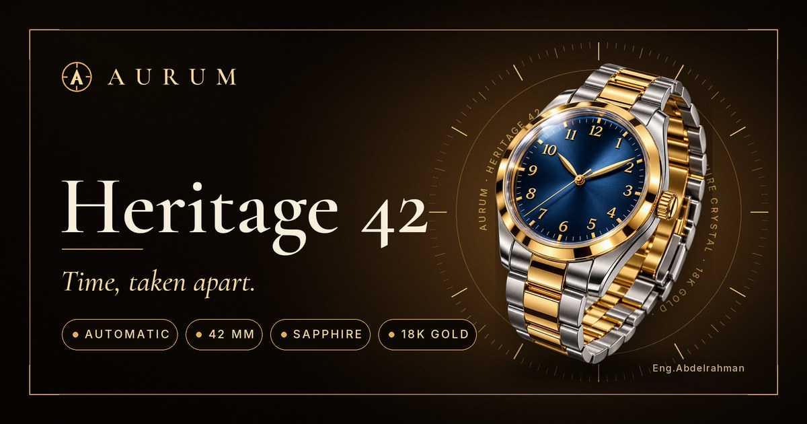

# AURUM — Heritage 42

**A cinematic, scroll-driven luxury-watch website.**
One scroll takes the watch apart — case, crystal, bezel, dial, movement — then opens a collection of nine.
Fast, bilingual (EN / AR), secure by construction, and built to be found by search engines **and** AI answer engines.


<sub>The story, recorded from the running site: one scroll, one timeline.</sub>

</div>

## Contents

[Highlights](#highlights) · [Screens](#screens) · [How the story works](#how-the-story-works) · [Quick start](#quick-start) · [Customise](#customise) · [SEO & GEO](#seo--geo) · [Security](#security) · [Performance & scale](#performance--scale) · [Deploy](#deploy) · [Tested sizes](#tested-sizes) · [Structure](#project-structure) · [Credits](#credits)

## Highlights

| | |
|---|---|
| 🎞 **Scroll-driven story** | One GSAP timeline scrubbed by scroll: the watch lifts, the dial reveals, the movement shows. Pictures hand over with a soft cross-melt and a little motion — no dividers — and the two round ones (dial and movement) turn in opposite directions as they slide across. |
| 🧭 **Engraved dial ring** | A tick ring and a legend ring sit behind every picture, turn with the scroll (and slowly on their own), and are sized from the picture so they are always whole — from phones to ultra-wide screens. |
| 🔩 **Craftsmanship reel** | Ten parts of the watch (crystal, bezel, dial, **hands**, movement, case…) in a swipeable, auto-playing reel with a light sweep across the whole card on every change. |
| 🛍 **Collection** | Nine watches with filters, detail pages, pricing table, and cards that animate in from the side / bottom — every time, in both scroll directions — with counting numbers. |
| 🌍 **EN / AR** | English primary, Arabic secondary. Switching language only swaps text (no layout mirroring), with its own typography. |
| 📱 **Every screen** | Full-bleed heroes with text on the media, layouts rebuilt by `matchMedia` for portrait, landscape and tablet — *all copy stays visible on small screens*. |
| ⚡ **Preloaded & light** | Small, high-quality WebP / WebM, preloaded behind a loader, so nothing waits after the site is hosted. Sound starts after the first gesture. |
| ✉ **Working contact form** | Delivered by FormSubmit with a honeypot, a time trap, a 30 s cool-down and strict validation. |

---

## Screens

<table>
<tr>
<td width="50%">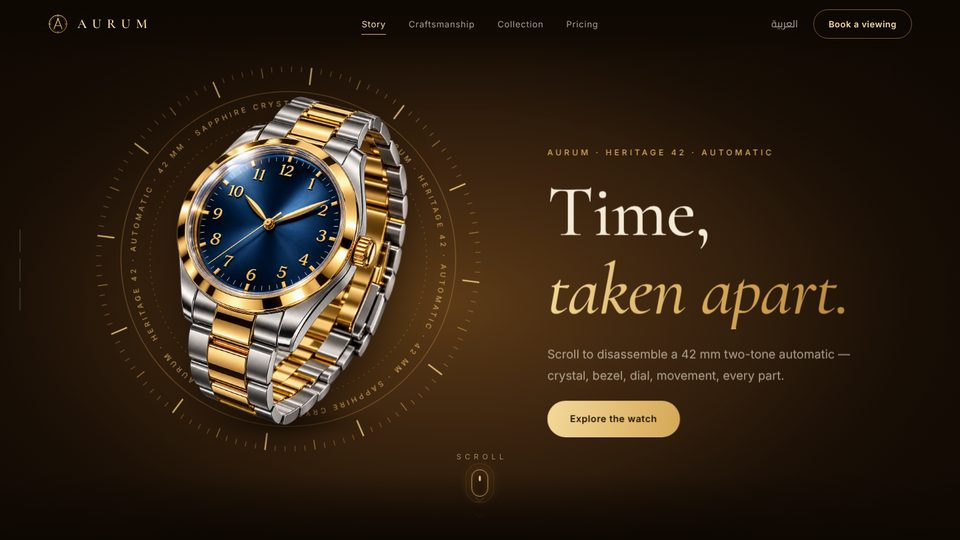</td>
<td width="50%">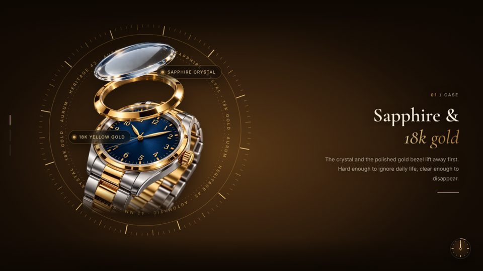</td>
</tr>
<tr>
<td>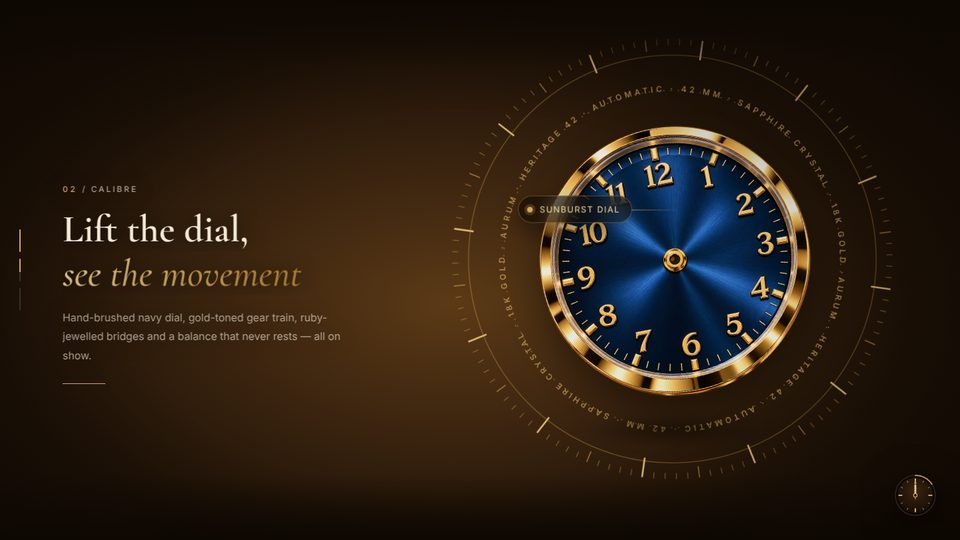</td>
<td>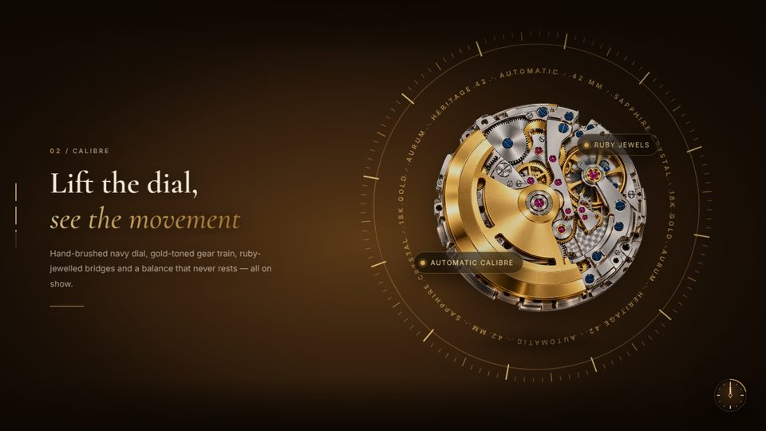</td>
</tr>
<tr>
<td>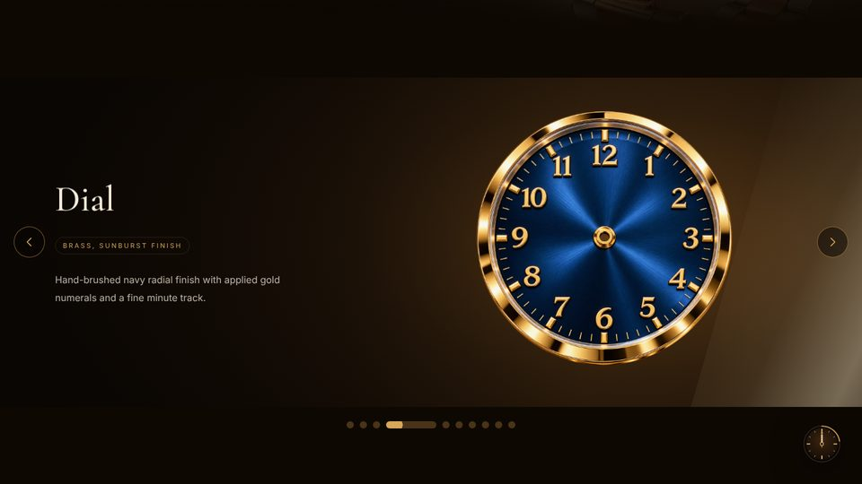</td>
<td>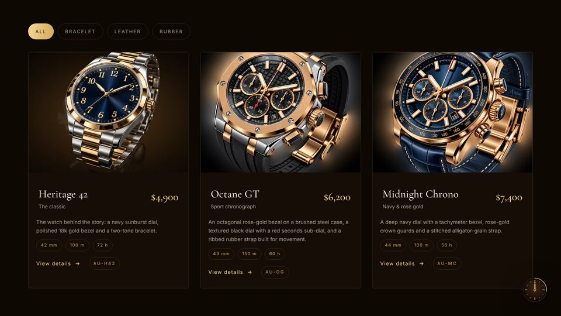</td>
</tr>
<tr>
<td>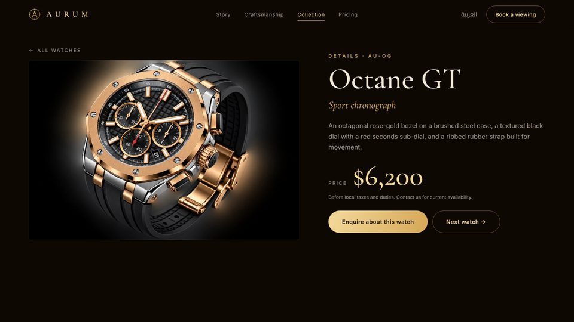</td>
<td>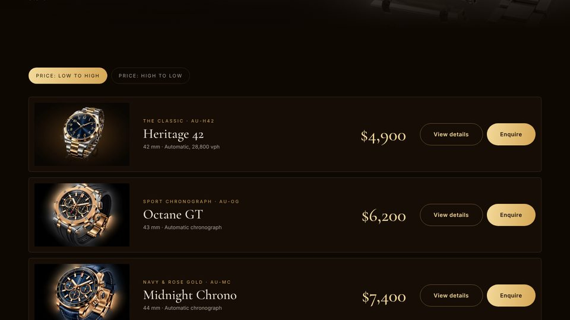</td>
</tr>
</table>

<p align="center">
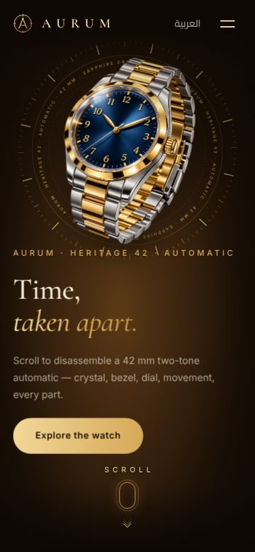
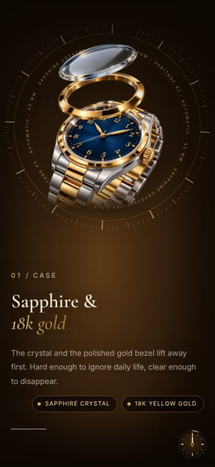
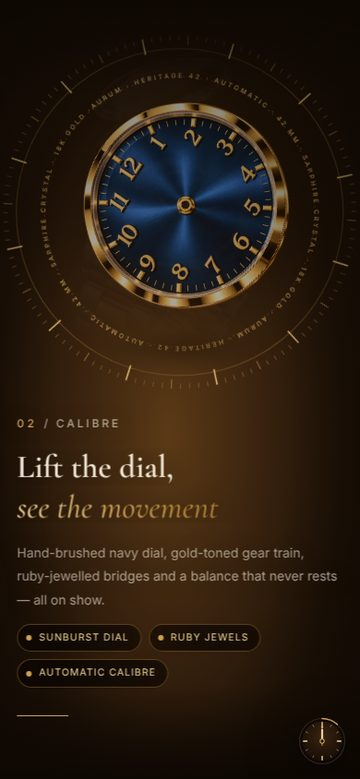
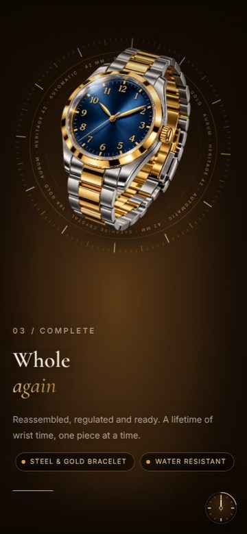
</p>

## How the story works

<p align="center">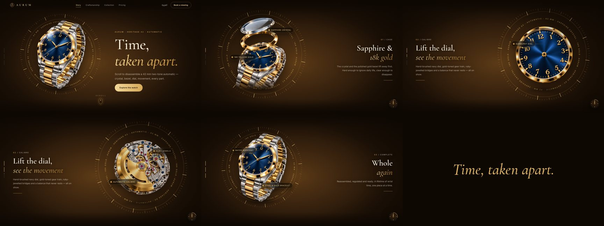</p>

- `Scene.tsx` builds **one** `gsap.timeline` bound to a pinned `ScrollTrigger` (scrub), rebuilt by `gsap.matchMedia` whenever the layout class changes (portrait / landscape / wide) and `invalidateOnRefresh` keeps positions right after a resize.
- Photos are separate transparent layers. The outgoing picture melts away slightly ahead of the incoming one (opacity + scale), so two watches are never clearly on screen together. Dial and movement rotate against each other while sliding across the width; the engraved ring steps back as the whole watch returns and comes back softly.
- Smooth scrolling is **Lenis**, driven by the GSAP ticker so scrub and scroll never disagree.
- A language switch rebuilds the timeline from clean elements and re-syncs it to the current scroll, so chapter titles are always there.
- `useReveal` gives every `[data-r]` card a reveal that works **both** directions, replays, counts numbers up again (the number's final width is reserved so counting never re-wraps a card) and self-heals after resize. GSAP owns `transform`/`opacity`; CSS transitions on those are disabled for revealed cards so nothing fights the animation.
- The scroll cue under the intro jumps past the first picture and lands on the second one, complete.

## Quick start

```bash
npm install
npm run dev            # http://localhost:5173
npm run build          # type-check + build + prerender (see SEO)
npm run preview        # http://localhost:4173
```

Requires Node 18+. Production build with your domain:

```bash
SITE_URL=https://your-domain.com npm run build
```

## Customise

| What | Where |
|---|---|
| Watches, prices, specs, copy (EN + AR) | `src/lib/watches.ts` — everything (cards, pricing, detail pages, SEO, JSON-LD) updates from here |
| Site copy, both languages | `src/lib/dict.ts` |
| Contact e-mail, social links | `src/lib/config.ts` |
| SEO titles, descriptions, author identity | `src/lib/seoData.ts` |
| Colours, spacing, motion | `src/styles.css`, `src/styles-ui.css` |
| Share (Open Graph) images | `public/og/*.jpg` (1200×630) |


## Security

A static site has no server code, database or login to attack — and what remains is locked down:

- **Content-Security-Policy** (`script-src 'self'`, no inline scripts, `frame-ancestors 'none'`, `object-src 'none'`, `form-action` limited to FormSubmit), **HSTS** (preload-ready), `X-Content-Type-Options`, `X-Frame-Options`, `Referrer-Policy`, `Permissions-Policy`, COOP — shipped in `public/_headers` (Cloudflare Pages / Netlify) and `vercel.json`.
- **Fonts are self-hosted** (`@fontsource`): no third-party requests, no tracking, faster first paint.
- **Form hardening** — honeypot, minimum-time trap, 30 s cool-down, length caps, e-mail validation; the only network call goes to FormSubmit.
- **Dependencies** — `npm audit --omit=dev` reports 0 vulnerabilities (React Router 7). No production source maps. `/.well-known/security.txt` included.

> No website can be promised "unhackable". This setup removes the common attack surface; keep dependencies updated and put the site behind a CDN with WAF / rate limiting (see `DEPLOY.md`).

## Performance & scale

Output is plain static files, so traffic is a CDN problem, not a server problem.

- Hashed assets and media are served `immutable` for one year; HTML is revalidated.
- Pictures are WebP, video is WebM + MP4 with posters, all preloaded behind the loader.
- Host on **Cloudflare Pages** (unlimited bandwidth, DDoS protection) or Netlify / Vercel and the site absorbs large visitor spikes without anything to overload.

## Deploy

```bash
SITE_URL=https://your-domain.com npm run build   # → dist/
```

Upload `dist/` to Cloudflare Pages / Netlify / Vercel (or push this repo and set the build command to `npm run build`, output `dist`). Full checklist: [`DEPLOY.md`](DEPLOY.md).

## Publish on GitHub

```bash
cd aurum-heritage-42
git init
git add .
git commit -m "AURUM — Heritage 42"
git branch -M main
git remote add origin https://github.com/<your-user>/aurum-heritage-42.git
git push -u origin main
```

- `.github/workflows/ci.yml` builds the site and audits dependencies on every push.
- **Hosting:** Cloudflare Pages is recommended (security headers, unlimited bandwidth, WAF). Connect the repo, build command `npm run build`, output `dist`, and set `SITE_URL`.
- **GitHub Pages** also works — but only at the root of a custom domain or a `<user>.github.io` site (the site uses root-relative paths, so a `/<repo>/` sub-path would break media). Add the repository variable `SITE_URL`, set Pages → Source to *GitHub Actions*, then run **Deploy to GitHub Pages**. Pages can't send HTTP headers, so the build also embeds a Content-Security-Policy `<meta>` tag.
- Don't commit secrets: `.env` is ignored; only `.env.example` is tracked.

## Tested sizes

Headless Chromium screenshots and scroll tests at **320×568 · 360×640 · 390×667 · 390×844 · 717×890 · 913×915 · 1012×920 · 1440×820 · 1920×1080 · 844×390 (landscape phone)** — no overlaps, no hidden copy, no stuck or trembling cards when scrolling down and up. Run it yourself with Playwright against `npm run preview`.

## Project structure

```text
├─ index.html                 head template (managed SEO block between markers)
├─ scripts/seo.mjs            post-build prerender + sitemap / robots / llms.txt / security.txt
├─ public/
│  ├─ img/ video/             optimised media (WebP · WebM/MP4)
│  ├─ og/                     share images 1200×630
│  ├─ icons/ manifest         PWA / touch icons
│  └─ _headers · _redirects   security + cache headers (Cloudflare / Netlify)
├─ vercel.json                same headers & redirects for Vercel
├─ docs/                      README assets (animated SVGs, screenshots)
└─ src/
   ├─ components/             Scene (story) · Reel · DialRing · Collection · Seo · …
   ├─ pages/                  Home · Anatomy · Collection · Watch · Pricing · About · Legal
   └─ lib/                    watches · dict · seoData · useReveal · nav · smooth · sound
```

## Credits

Designed and built by **Abdelrahman Jehad Aldasht** — *Abd Elrahman Jehad Eldasht* — **عبد الرحمن جهاد الدشت**.

<sub>The watch photographs are used as demonstration material. Before commercial use, make sure you hold the rights to every image and video, and that no third-party marks appear on the watches you publish.</sub>

<details>
<summary><b>بالعربي · ملخّص سريع</b></summary>

<div dir="rtl">

**AURUM — هيريتج 42** موقع ساعات فاخرة بتجربة تمرير سينمائية: بتفكّك الساعة قطعة قطعة (الزجاج، الإطار، الميناء، الحركة) وبعدها مجموعة من تسع ساعات.

- واجهة بالإنجليزية والعربية؛ تبديل اللغة بيغيّر النص فقط بدون قلب التصميم.
- يشتغل على كل المقاسات، وكل النصوص بتبقى ظاهرة على الشاشات الصغيرة.
- SEO وGEO: صفحات جاهزة للمحركات، بيانات منظّمة، `sitemap`, `robots`, `llms.txt`، وصور مشاركة احترافية.
- أمان: ترويسات حماية وCSP، خطوط محلية، نموذج تواصل محصّن.
- موقع ثابت (static) على CDN، فيتحمّل عدد زوار كبير بدون سيرفر يقع.

للتشغيل: `npm install` ثم `npm run dev`. للنشر: `SITE_URL=https://your-domain.com npm run build` ثم ارفع مجلد `dist`.

</div>
</details>

